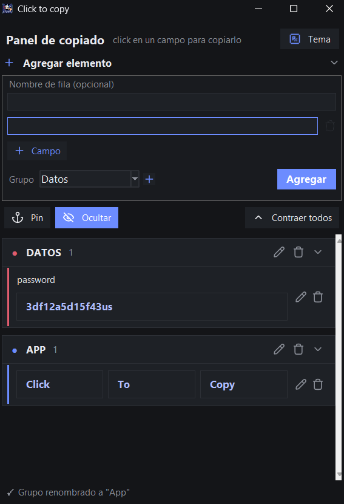
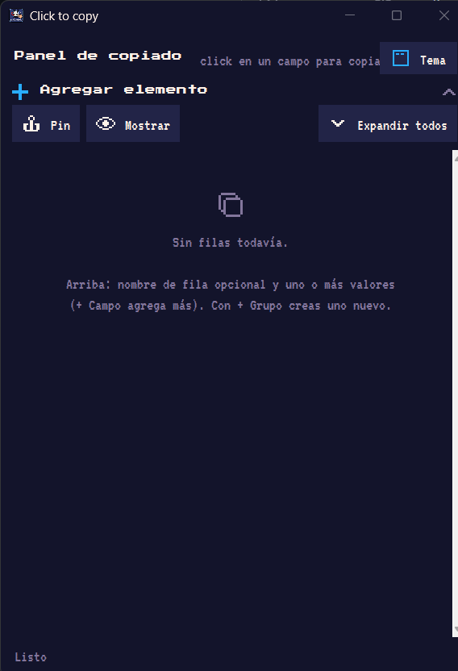
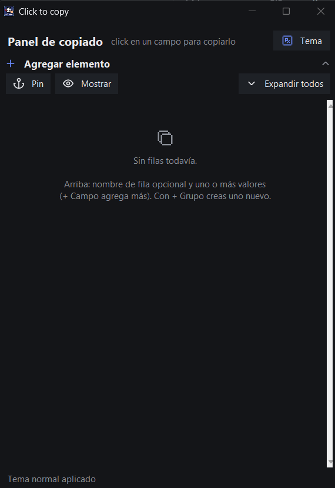

# ClickToCopy (C2C)

Panel de escritorio (Windows) para copiar datos con un solo click.
Ideal para datos que usas todo el tiempo y no quieres tener a la vista: cuentas,
códigos, RFC, tarjetas, direcciones, etc. Incluye dos temas visuales: **pixel art**
(Pico-8) y **normal** (sobrio), conmutables desde la app.

> Click en un campo → se copia al portapapeles. Los valores quedan ocultos (`███`).

## Características

- **Filas multi-campo**: cada fila puede tener 1, 2 o 3 campos; cada campo es un valor que se copia con un click.
- **Valores ocultos**: los datos se muestran como `███`; botón para revelar/ocultar todo.
- **Categorías plegables**: los datos se agrupan por categorías con color propio, que se pliegan/despliegan.
- **Fijar ventana**: modo "siempre visible" (top-most) para tenerlo encima de otras apps.
- **Guardado automático**: todo se guarda en `datos.json` al instante, sin botones.
- **Dos temas**: pixel art (Pico-8) y normal (sobrio), conmutables desde la app.
- **Sin consola**: se puede ejecutar como `.exe` compilado o vía `pythonw`.

## Capturas

Panel con datos, con el formulario para agregar elementos (tema normal):



Tema pixel art (Pico-8):



Tema normal (sobrio):



## Requisitos

- Windows
- Python 3.8+ (probado en 3.12) con **tkinter** (incluido en el instalador oficial)
- `tksvg` (iconos Pixelarticons en SVG)
- `pyperclip` (opcional: mejora la copia al portapapeles; si falta, se usa un respaldo con Tk)

```bash
pip install tksvg pyperclip
```

El tema pixel art usa las fuentes `Press Start 2P` y `VT323` (ambas bajo SIL OFL), que
se cargan en privado solo para la app; no hace falta instalarlas. El tema normal usa
`Segoe UI`, incluida en Windows.

## Ejecución

### Con Python

```bash
python clicktocopy.py
```

o doble click en `clicktocopy.bat` (usa `pythonw`, sin ventana de consola).

### Como ejecutable (.exe)

```bash
pip install pyinstaller
python -m PyInstaller --noconsole --onefile --name ClickToCopy --icon clicktocopy.ico ^
    --add-data "fonts;fonts" --add-data "clicktocopy.png;." --collect-all tksvg clicktocopy.py
```

El exe queda en `dist\ClickToCopy.exe`. Los recursos (fuentes e icono) van empacados
dentro; `datos.json` y `config.json` se crean/usan **junto al exe**.

## Estructura

| Archivo | Descripción |
|---|---|
| `clicktocopy.py` | Código de la app (Tkinter, un solo archivo) |
| `panel.bat` | Lanzador con `pythonw` |
| `datos.json` | **Tus datos** (se genera solo; no subir a GitHub) |
| `config.json` | Tema guardado (se genera solo) |
| `clicktocopy.png` / `clicktocopy.ico` | Icono de la app |
| `fonts/` | Fuentes pixel (SIL OFL) |

## Datos

- `datos.json` guarda **todo lo que copias con la app** — contiene información sensible.
- No lo subas a ningún repositorio (ya está excluido en `.gitignore`).
- Para respaldar o migrar, basta copiar ese archivo junto al panel.

## Licencia

Código bajo licencia [MIT](LICENSE) — Copyright © 2026 Alejandro Álvarez.
Fuentes incluidas: [Press Start 2P](https://fonts.google.com/specimen/Press+Start+2P) y
[VT323](https://fonts.google.com/specimen/VT323) bajo [SIL Open Font License](https://scripts.sil.org/OFL).
Iconos: [Pixelarticons](https://pixelarticons.com/).
